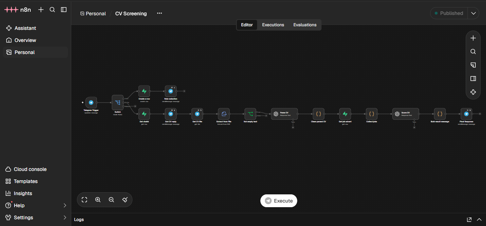
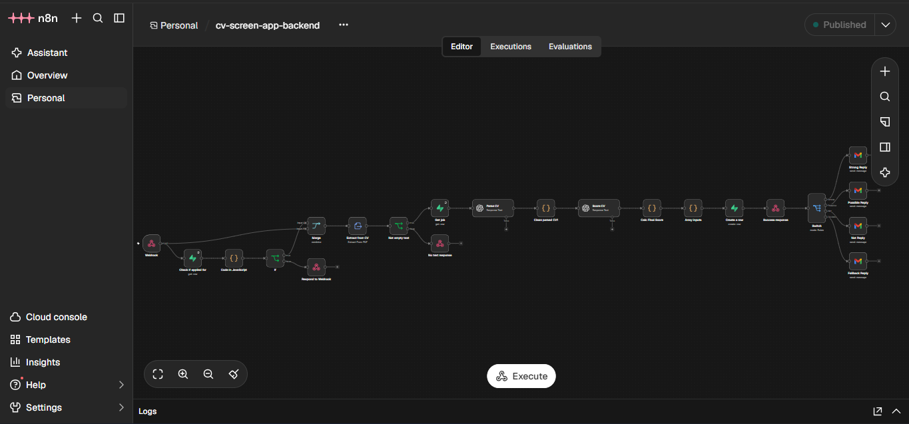

# cvscreen-bot-workflows

Two importable [n8n](https://n8n.io) workflows that screen CVs against open roles using OpenAI, backed by a shared Supabase project.

## Workflows

### 1. CV Screening Telegram bot (`workflows/telegram-workflow.json`)

A candidate messages the bot, sends a CV as a PDF, and gets back the roles they match.

- `/start` registers the chat in `telegram_sessions` and replies with instructions; any other message with a document is treated as a CV.
- The PDF is downloaded and its text extracted, then GPT-4.1-mini parses it into structured JSON (name, contact, skills, education, experience, certifications).
- All `status = active` rows in `jobs` are collected and the CV is scored against every role at once (skills / experience / education / additional, 0–100 each).
- The CV is analyzed against the job requirements and appropriate response sent back through the chat.

### 2. cv-screen-app-backend (`workflows/mobile-app-workflow.json`)

`POST /webhook/upload-application`: the backend for the mobile app's single-role application flow.

- Guards against duplicates: if the `user_id` already has an application for that `job_title` in `applications`, the request short-circuits with *"You have already made an application for this role."*
- Extracts the CV text (a 422 is returned if the PDF has no readable text), looks up the role in `jobs`, parses and scores the CV with GPT-4.1-mini.
- The final score uses the per-job weights stored on the `jobs` row (`W_Skills`, `W_Experience`, `W_Education`, `W_Certs`, defaulting to 40/30/20/10) and maps to `Strong Match` (≥75), `Possible Match` (≥50) or `Not a Match`.
- Writes the breakdown (overall, per-category scores, summary, strengths, weaknesses, status) to `applications` and returns `{ success, id, overall_score, status }` to the app.
- Sends the candidate a Gmail reply matched to the status, with a fallback acknowledgement email when the status is unrecognised.

## Supabase tables

Supabase used as the main data store for all read and writes made throughtout the application process.

## Import

In n8n: **Workflows → Import from File**, then re-credential the Telegram, OpenAI, Supabase and Gmail nodes.
